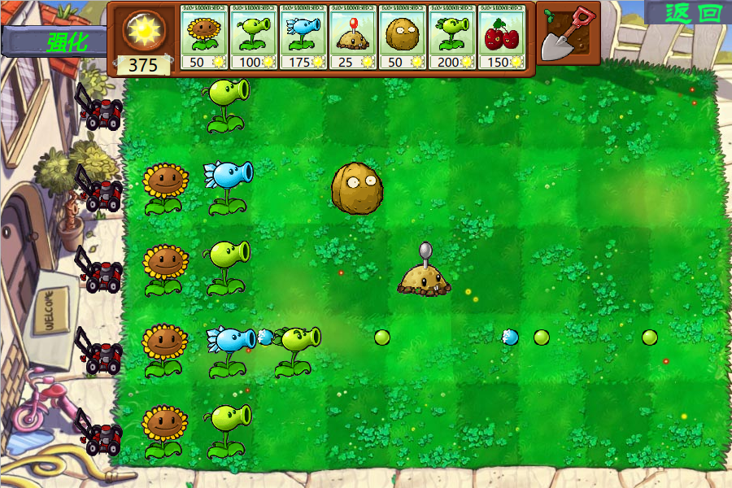

# 植物大战僵尸 · Qt 课程项目

用 C++ 和 Qt Widgets 实现的五行草坪塔防游戏。开局有 1500 阳光，可以先种向日葵积累资源，再用寒冰射手减速、坚果阻挡、双发射手输出。游戏采用无尽模式，普通、路障、铁桶、铁网门、橄榄球和超级橄榄球僵尸会陆续出现。每行草坪左侧的小推车提供一次最后防守。



## 构建与启动

准备支持 C++17 的桌面编译器，以及包含 qmake、Core、Gui、Widgets、Multimedia 的 Qt 桌面开发套件。Windows 下要让 Qt 与编译器匹配，例如 MinGW 版 Qt 搭配对应版本的 MinGW。

1. 在 Qt Creator 选择「打开文件或项目」，打开仓库根目录的 `pvz-Qt.pro`。
2. 选择桌面构建套件（Desktop Kit）并配置项目。
3. 按 `Ctrl+R` 构建并运行。在主菜单点击「开始」，再点击僵尸留下的纸条，进入草坪。

以下命令从仓库根目录执行，已在 Ubuntu 24.04、Qt 5.15.13 下完成构建和启动验证。Ubuntu 所需的开发包为 `build-essential`、`qtbase5-dev` 和 `qtmultimedia5-dev`。

```sh
mkdir -p build
cd build
qmake ../pvz-Qt.pro
make -j4
./pvz-Qt
```

`res.qrc` 会把 `resources/` 下的图片、动画和音频编入程序。配置阶段出现 `Unknown module(s) in QT: multimedia` 时，请给当前构建套件补装 Qt Multimedia 开发模块。

## 操作

| 操作 | 方法 |
| --- | --- |
| 收集阳光 | 单击自然掉落或向日葵产出的阳光。 |
| 种植 | 单击植物卡片，再单击草坪空格。开局铲子默认选中，第一次点卡片会取消铲子，再点一次即可选卡。 |
| 取消选卡 | 在草坪上单击鼠标右键。 |
| 铲除 | 选中铲子，再单击要移除的植物。 |
| 强化 | 点击「强化」再点植物，可触发额外效果，例如让向日葵在短时间内连续产出阳光。 |
| 暂停或继续 | 按空格键。 |

七种植物的阳光消耗分别为土豆地雷 25、向日葵和坚果各 50、豌豆射手 100、樱桃炸弹 150、寒冰射手 175、双发射手 200。主菜单的「帮助」提供植物、僵尸和强化技能图鉴。

## 源码导览

| 入口 | 职责 |
| --- | --- |
| `main.cpp`、`beginscene.cpp`、`zombienote.cpp` | 程序入口、主菜单和对局前的纸条 |
| `mainwindow.cpp` | 创建游戏场景、驱动主循环、安排僵尸出场 |
| `map.cpp`、`card.cpp`、`selectplants.cpp` | 草坪格点、植物选择、阳光计数与消耗 |
| `plants.cpp`、`zombie.cpp` 及各角色同名文件 | 角色基类、攻击、移动和动画 |
| `button.cpp`、`sun.cpp`、`car.cpp` | 强化与铲子、可收集的阳光、草坪小推车 |
| `resources/`、`res.qrc` | 游戏素材与 Qt 资源清单 |

[原课程仓库（南京大学 GitLab）](https://git.nju.edu.cn/Wall/pvz)
